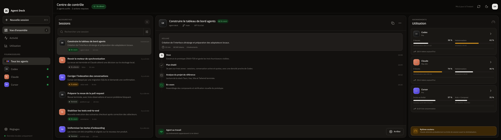

# Agent Deck

Tableau de bord macOS en lecture seule pour suivre les sessions et l’utilisation de Codex, Claude et Cursor depuis une seule fenêtre.



## Fonctionnalités

- agrégation des conversations récentes de Codex, Claude et Cursor ;
- suivi des quotas, fenêtres de réinitialisation et mesures d’utilisation disponibles ;
- actualisation automatique des données locales ;
- interface tactile optimisée pour un écran ultralarge 2560 × 720 ;
- mise en page responsive avec détail de session dans un panneau latéral sur les formats compacts ;
- interface disponible en français et en anglais ;
- application strictement en lecture seule : aucune création, reprise ou modification de session.

## Langues

Au premier lancement, Agent Deck utilise le français lorsque la langue système commence par `fr`, et l’anglais dans tous les autres cas. Le sélecteur `FR` / `EN` de la barre supérieure change immédiatement tous les textes d’interface, les dates et les nombres. Le choix manuel est mémorisé localement et prévaut aux lancements suivants.

Les titres et messages des conversations réelles restent dans leur langue d’origine. Seuls les libellés créés par Agent Deck sont traduits. Les données de démonstration, utilisées par `pnpm dev` dans un navigateur, disposent de catalogues français et anglais.

## Sources de données

Agent Deck ne dépend pas d’un serveur distant propre au projet. Les adaptateurs Rust lisent les données déjà présentes sur le Mac :

- **Codex** : tâches de `~/.codex/state_5.sqlite`, rollouts JSONL et quotas exposés par le `codex app-server` fourni avec l’app ;
- **Claude** : conversations de `~/.claude/projects`, métadonnées de Claude Desktop, historique local d’utilisation et endpoint OAuth Anthropic lorsque des identifiants compatibles sont disponibles ;
- **Cursor** : conversations de `state.vscdb` et résumé d’utilisation Cursor à partir de la session locale.

Les bases sont ouvertes en lecture seule. Les jetons restent côté Rust et ne sont jamais envoyés à l’interface Vue.

> Les formats locaux de ces applications ne constituent pas des API publiques stables. Une mise à jour de Codex, Claude ou Cursor peut nécessiter une adaptation des parseurs.

## Stack

- Tauri 2 et Rust
- Vue 3, TypeScript et Vue I18n 11
- Vite 8 et Tailwind CSS 4
- VueUse, Lucide et Vitest

## Prérequis

- macOS ;
- Node.js 22 ou plus récent ;
- pnpm 10 ;
- toolchain Rust stable ;
- les apps Codex, Claude et/ou Cursor installées et déjà utilisées.

## Installation

```bash
git clone https://github.com/eMeRiKa13/agent-deck.git
cd agent-deck
pnpm install
pnpm dev:desktop
```

La configuration Tauri lance Vite sur `http://127.0.0.1:1421` puis ouvre la fenêtre native macOS.

Pour travailler uniquement sur l’interface avec les données de démonstration :

```bash
pnpm dev
```

## Vérification

```bash
pnpm typecheck
pnpm test
pnpm build
pnpm build:desktop
```

Les tests unitaires Rust peuvent aussi être lancés directement :

```bash
PATH="$HOME/.cargo/bin:$PATH" cargo test --manifest-path src-tauri/Cargo.toml
```

Les smoke tests qui dépendent des données installées localement sont ignorés par défaut :

```bash
PATH="$HOME/.cargo/bin:$PATH" cargo test --manifest-path src-tauri/Cargo.toml -- --ignored
```

## Structure

```text
src/                    Interface Vue et données de démonstration
src/components/         Composants du tableau de bord
src/composables/        Polling et état applicatif
src-tauri/src/providers Adaptateurs Codex, Claude et Cursor
src-tauri/              Configuration et backend Tauri
```

## Confidentialité

Agent Deck fonctionne localement. Il n’envoie aucune conversation à un service tiers et n’expose pas les identifiants récupérés par les adaptateurs Rust au frontend.
