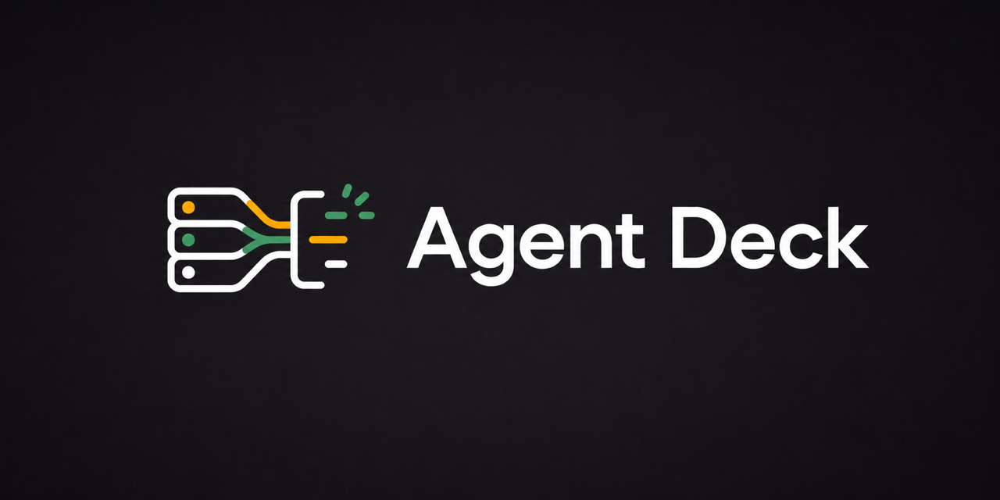

<p align="center">
  
</p>

# Agent Deck

Agent Deck is a read-only macOS dashboard that brings your Codex, Claude, and Cursor activity into one place.

Agent Deck is an independent source project. It is not affiliated with,
endorsed by, or sponsored by OpenAI, Anthropic, Anysphere, GitHub, or Corsair.

It was built specifically for the [CORSAIR XENEON EDGE 14.5-inch LCD touchscreen](https://www.corsair.com/fr/fr/p/monitors/cc-9011311-ww/corsair-xeneon-edge-14-5-lcd-touchscreen-white-cc-9011311-ww). The display’s native 2560 × 720, 32:9 canvas shaped Agent Deck’s three-pane layout and touch-friendly sizing.


## A companion display for AI coding sessions

Codex, Claude, and Cursor each keep their conversations and usage information in a different place. Agent Deck turns those separate sources into a single, glanceable workspace.

The app is designed to stay open beside your main display or on a dedicated touchscreen. At a glance, you can see which agents are working, which sessions need attention, what happened in the selected conversation, and how much of each subscription quota you have used.

Agent Deck is intentionally passive. It does not create sessions, send prompts, resume work, or change provider settings.

## What you can monitor

- Recent Codex, Claude, and Cursor sessions in one unified list.
- Working, waiting, completed, and attention-required states.
- The selected conversation’s summary, recent events, model, branch, duration, and token count.
- Available plan limits, reset times, credits, and usage measurements.
- Provider availability and partial-data warnings.
- Automatic refresh every 15 seconds without interrupting the interface.

On narrower displays, Agent Deck keeps sessions and usage visible while opening conversation details in a slide-over panel.

The interface follows your light or dark system appearance and supports English and French. A manual language choice is stored locally.

## Understand the local data boundary

Agent Deck has no account system and no dedicated cloud service. Its Rust adapters read the files and authenticated sessions already created by the installed desktop applications.

| Provider | Conversations | Usage |
| --- | --- | --- |
| Codex | `~/.codex/state_5.sqlite` and JSONL rollouts | The `codex app-server` bundled with the Codex app |
| Claude | `~/.claude/projects` and Claude Desktop session metadata | Live Claude Desktop usage using its signed-in session, with Anthropic OAuth as fallback |
| Cursor | Cursor’s local `state.vscdb` database | Cursor’s usage summary using the existing local session |

Local databases are opened in read-only mode. Conversation titles, summaries,
activity, project names, and usage measurements are serialized to the local Vue
interface for display. Credentials and tokens remain in the Rust backend and
are never serialized to Vue or written by Agent Deck.

> These local formats are implementation details rather than stable public APIs. Updates to Codex, Claude, or Cursor may require adapter changes.

### Network access

Agent Deck has no dedicated cloud service and does not upload conversations to
an Agent Deck server. The Rust backend makes these authenticated requests only
to retrieve account and quota information:

| Provider | Destination | Purpose |
| --- | --- | --- |
| Codex | The local `codex app-server` process | Read the authenticated account and rate limits. The Codex process manages its own provider connection. |
| Claude | `https://api.anthropic.com/api/oauth/usage` | Read OAuth usage windows when local credentials are available. |
| Claude Desktop | `https://claude.ai/api/organizations` and `/api/organizations/{id}/usage` | Read the active Desktop organization's current limits using its existing session. |
| Cursor | `https://cursor.com/api/usage-summary` and `https://cursor.com/api/auth/me` | Read plan usage and account metadata using the existing local session. |

The About panel can open allow-listed GitHub, Enchanter, and Corsair pages after
you select their links. The Vue frontend cannot initiate arbitrary external
connections.

On macOS, live Claude Desktop usage reads only the `sessionKey` and
`lastActiveOrg` cookies from Claude's own cookie database, opened read-only.
macOS may ask for access to the **Claude Safe Storage** Keychain item on the
first refresh. Cookie decryption stays in Rust, and no credentials are saved by
Agent Deck or exposed to Vue. The selected organization is checked against the
authenticated session; multiple organizations without an active selection are
reported as unavailable rather than guessed. Browser cookie stores are not used.

Claude's current `limits[]` measurements take precedence over legacy usage
fields. The Desktop `plan-usage-history.json` file is no longer used for quotas,
because newer Desktop versions can record zero placeholders there. Both current
`codex-cli/` bundles and older Codex binary locations are supported, without
requiring a separate CLI installation.

Usage percentages consistently mean **used**, with a live countdown until each
provider-reported reset. Exact dates, credits, costs, and model-specific limits
are available in expandable details. Codex windows are named from their actual
duration; Cursor's monthly model allowances share the reported billing-cycle end.

Free full-reset offers are shown only when explicitly returned by the provider:
Codex's `rateLimitResetCredits`, or Claude's `cedar_ember.grants` from the usage
request with `?cedar_ember=1`. Only counts and expiration dates reach Vue; grant
identifiers are not exposed. Expired offers are hidden, and Agent Deck never
calls a redemption endpoint or resets a quota.

## Run Agent Deck from source

Agent Deck does not provide an official downloadable binary. Build and run it
from source. The current release is tested on Apple Silicon; Intel Macs and
other operating systems are not verified.

You need macOS, Node.js 22 or later, pnpm 10.33, a stable Rust toolchain, and at
least one supported app that has already been used on the Mac.

```bash
git clone https://github.com/eMeRiKa13/agent-deck.git
cd agent-deck
pnpm install
pnpm dev:desktop
```

Tauri starts the frontend at `http://127.0.0.1:1421` and opens the native macOS window. Agent Deck refreshes local sessions every 15 seconds and usage quotas every 2 minutes. A manual refresh updates both immediately.

To work on the interface in a browser without reading local application data, run the demo adapter:

```bash
pnpm dev
```

## Develop and verify

Agent Deck uses Tauri 2 and Rust for local data access, with Vue 3, TypeScript, Vue I18n, Vite, and Tailwind CSS for the interface.

Run the frontend checks:

```bash
pnpm typecheck
pnpm test
pnpm build
```

Run the Rust checks:

```bash
PATH="$HOME/.cargo/bin:$PATH" cargo fmt --manifest-path src-tauri/Cargo.toml -- --check
PATH="$HOME/.cargo/bin:$PATH" cargo clippy --manifest-path src-tauri/Cargo.toml --all-targets -- -D warnings
PATH="$HOME/.cargo/bin:$PATH" cargo test --manifest-path src-tauri/Cargo.toml
```

Build the desktop application:

```bash
pnpm build:desktop
```

Cargo keeps compiled dependencies and incremental build caches in `src-tauri/target/`.
The directory is ignored by Git and can be safely regenerated. If it grows
too large, reclaim the space with:

```bash
pnpm clean:rust
```

Development and test profiles keep line tables for useful Rust backtraces but
omit debug symbols from third-party dependencies to limit future growth. Use
`CARGO_PROFILE_DEV_DEBUG=2` temporarily when a native debugging session needs
full symbols.

Smoke tests that inspect installed application data are ignored by default. Run them explicitly with:

```bash
PATH="$HOME/.cargo/bin:$PATH" cargo test --manifest-path src-tauri/Cargo.toml -- --ignored
```

## Project structure

```text
src/                    Vue interface and browser demo data
src/components/         Dashboard components
src/composables/        Polling and application state
src-tauri/src/providers Codex, Claude, and Cursor adapters
src-tauri/              Tauri configuration and Rust backend
```

## Privacy

Agent Deck runs locally. It does not upload conversations to an Agent Deck service or expose credentials collected by the provider adapters to the frontend.

Report security issues through the private process in [`SECURITY.md`](./SECURITY.md).

## License and trademarks

Agent Deck source code is available under the [MIT License](./LICENSE).
Third-party icons, names, and trademarks remain the property of their
respective owners; see [`THIRD_PARTY_NOTICES.md`](./THIRD_PARTY_NOTICES.md).

This repository is published as a showcase and does not currently accept
unsolicited issues or pull requests. See [`CONTRIBUTING.md`](./CONTRIBUTING.md).
